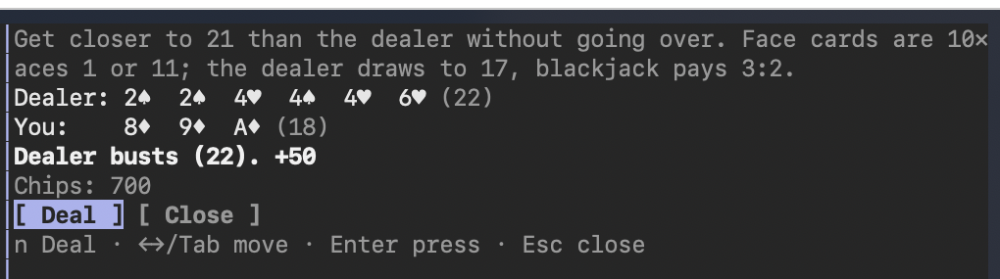

# Blackjack mod for Claude Code

When Claude starts a task it expects to take a while, it offers you a hand of blackjack in a side pane. You play while it works.

```
🃏 Big refactor – this will take a while. Fancy a hand of blackjack?  [ Play ] [ No thanks ] [ Don't ask again ]
```



## How it works

- The mod registers a tool, `mcp__blackjack__offer_blackjack`. **Claude itself decides** when to call it: at the start of each long task. There is no timer or heuristic.
- The offer appears as a band above the prompt: at most once per task, never while you're already playing. **Don't ask again** turns it off for good.
- The game runs locally in a pane: it uses no tokens, and the model never sees it.
  - Keys: `h` Hit, `s` Stand, `d` Double, `n` new deal; arrows/Tab move between buttons, Enter presses; `Esc` closes the table.
  - Rules: a 4-deck shoe, the dealer draws to 17, blackjack pays 3:2, the bet is 50.
- Chips persist across sessions. You start with 1000, and when you run out you get a fresh 1000.
- When Claude finishes, the status line tells you, and the game stays open.
- `/blackjack` opens the table at any time, even while a turn is running.

## Install

```sh
claude --plugin-dir /path/to/blackjack_mod
```

or set `CLAUDE_CODE_PLUGIN_DIRS=/path/to/blackjack_mod`.

## Develop

```sh
claude plugin validate .
claude plugin test .
```
